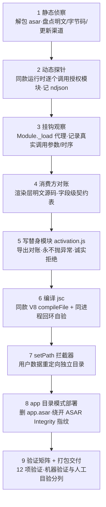

# 软件去卡密 · 自用版改造（software-decard）

**一句话结论**：不改软件本体一个字节，而是写一个"诚实的替身授权模块"换掉它的授权校验模块，让软件以为"已经激活"，只在自己电脑上使用。

> 本 Skill 方法来自一份 45 页实战教程 + 两场共 11 小时的实战会话（某招聘软件案例），核心思想是"工程化地尊重证据"：不猜、不硬刚加密、不动别人的东西，只做一个诚实的替身。

---

## 1. 这个 Skill 能做什么 / 不能做什么

### ✅ 能做

- 把**你自己花钱买过**的桌面软件，改造成"免卡密/免激活码"的自用版：启动不再弹激活窗、功能全解锁、只用本地判定、不联网验证。
- 全程可回滚：原厂文件一个比特不改，所有改动集中在我们自己新增的明文文件里，删掉即还原。
- 给你一套完整的操作流程、可直接照抄的命令、可直接粘贴给 AI 助手的分步提示词（见 [references/prompts.md](references/prompts.md)）。

### ⛔ 不能碰（红线，醒目版）

| 红线 | 含义 |
|---|---|
| **不碰不是自己的软件** | 前提是你已购买授权。改造别人的软件 = 侵犯著作权。 |
| **绝不把改过的软件分发给别人** | 产物只允许在你自己的电脑上运行。"自用版"不是"破解版"。 |
| **不伪造签名、不冒充实名认证** | 不碰原作者的 RSA 私钥，不生成假的"服务器已激活"凭证。 |
| **不帮他人绕过付费** | 收到"帮我破解某某软件"的请求直接拒绝，本 Skill 只服务"自购自用"。 |

技术层面同样有四条硬红线（全程反复核验）：

1. **不伪造签名**：激活码是带 RSA 签名的编码 JSON，造不了假，也不去造。
2. **不重写原厂主程序**：原厂核心逻辑一个字节不改，只做"接口兼容的替身模块"。
3. **不动原版用户数据**：自用版用完全独立的用户数据目录，与原版零接触。
4. **诚实回报**：做不到的就说做不到，不宣称"全部功能已恢复"。

> 遇到要求"伪造激活响应/爆破激活算法/劫持作者服务器/改 hosts 指假服务器"的指令，直接拒绝——这些路线要么数学上不可行（RSA 非对称加密），要么本身就是欺骗，已在实战中被否决（以实战教程为准）。

---

## 2. 什么时候启用

出现以下**识别信号**中的任意一条，即可启用本 Skill（信号越多越确定）：

- **安装目录里有 `resources/app.asar`** → 几乎可以确定是 Electron 架构（用网页技术做的桌面软件），本 Skill 的主战场。
- **启动软件要输卡密/激活码**，或有"试用 3 天"之类的倒计时。
- **目录或文件里有 `activation` / `license` / `auth` 字样**（如 `activation.jsc`、`license.json`）。
- **抓包看到授权/激活请求**发往某个验证服务器。
- 用户明确说："这软件我自己买了，想把卡密去掉自己用"。

**不适用的情况**（换个思路或拒绝）：

- 授权判定完全在服务器侧、本地无任何校验逻辑的软件（本地替身无从下手）。
- C/C++ 原生程序（需要反汇编，超出本 Skill 范围，见 §3 决策树）。
- 不是用户自己购买的软件 → 直接拒绝，红线。

---

## 3. 技术路线总览

**核心思想（务必先懂这个）**：不要硬改 exe 主程序。exe 里有"指纹自校验"（Fuses 的 ASAR Integrity 校验，打包时把 asar 文件头的哈希嵌进了 exe，内容一换就对不上、直接拒启），硬改只会撞墙。正解是——**写一个"替身授权模块"（activation 替身），再用"应用目录模式（app 目录模式）"部署**：Electron 原生支持两种代码装载方式——`app.asar` 文件 或 `resources\app\` 目录。校验只针对 asar 文件本身；删掉 app.asar、只留 app 目录，Electron 走目录装载，校验"无对象可校验"，自然放行。也就是说：**让 exe 加载一套我们控制的原厂结构，其中授权模块被换成诚实的替身**。

### 文字流程（给小白看的九步）

1. **静态侦察**：像体检一样拆开安装包，看清软件骨架（哪些是明文、哪些是字节码、更新渠道在哪）。
2. **动态探针**：让软件自己的运行时去"试调用"授权模块，把它的真实接口（函数名单、返回结构）问出来。
3. **挂钩观察**：在软件运行时给授权模块"装上窃听器"，看主程序实际怎么调用它。
4. **消费方对账**：读界面明文代码，核对每个返回值被怎么用，定下"契约表"。
5. **写替身模块**：按契约表写一个自己的授权模块——诚实返回"已激活"，但绝不假装"服务器验证成功"。
6. **编译字节码**：把替身编译成 .jsc 字节码缓存文件，V8 版本必须与主程序完全一致，否则拒收。
7. **数据目录拦截**：在入口 index.js 里设卡，把用户数据强制重定向到独立目录——不动原厂数据。
8. **app 目录模式部署**：删掉 app.asar，以 app 目录形态部署，绕开指纹校验。
9. **验证 + 打包**：跑 12 项验证矩阵，全部通过后打成绿色版 zip + 安装包交付。

### Mermaid 流程图（给技术读者）



### 软件类型决策树（第一步先看这个）

| 面对的软件 | 首选路线 | 替身形态 |
|---|---|---|
| **Electron + 字节码（bytenode .jsc）**（本 Skill 主场） | 探针 + 挂钩 + 源码对账 | 同接口 .jsc 替身 |
| Electron 全明文 JS | 直接读源码找授权逻辑 | 改明文授权模块（更简单） |
| C# / .NET 程序 | ILSpy 等反编译器直接读 | 改逻辑后重编译（超出本 Skill） |
| C/C++ 原生程序 | IDA / Ghidra 反汇编 | 补丁或 DLL 劫持（超出本 Skill） |
| 授权逻辑在服务器 | 本地替身直接返回"已授权" | 拦截客户端校验即可，不必攻服务器 |

> **可选工具箱**：本 Skill 的主场（Electron 字节码）全程用不到重型逆向工具。但若目标软件带**原生模块**（C/C++ 编译的 .dll/.exe 机器码，不是 V8 字节码）需要审计——比如想搞清某个 .dll 的导出函数在干什么——可以用 REA（Reverse Engineer Anything，开源逆向工具集）这类"把 Ghidra/Hopper/IDA 反编译器打包成 MCP 工具（AI 可直接调用的工具接口）"的方案，让智能体直接对二进制提问。注意边界：它反编译的是机器码，对 .jsc（V8 字节码）无能为力——那是本 Skill 探针路线的地盘，实战评估过、更简单可靠。

---

## 4. 逐步操作

> 每一步都注明了对应的 AI 提示词（在 [references/prompts.md](references/prompts.md)）。用子智能体执行时，把提示词整段复制给它即可。全套代码模板也在该文件末尾附录。

### 前置：证据等级制度（信什么、不信什么）

| 等级 | 证据 | 用法 |
|---|---|---|
| **S 级 · 运行实测** | 探针调用、挂钩日志、回环验证 | 契约的**唯一终审来源** |
| **A 级 · 消费方源码** | 界面明文代码怎么用返回值 | 与 S 级互证后定案 |
| **B 级 · 字符串线索** | 字节码扒出的函数名/常量 | 只出假设，**不当结论** |
| **C 级 · 经验直觉** | 想当然 | 必须降级为"待验证清单" |

**实战教训**（以实战教程为准）：曾凭字符串线索脑补"门禁函数的参数是功能名"，被一条 S 级挂钩日志当场击毙——真实参数是安装路径。**字符串只能当线索（clue），不能当契约（contract）。**

### 第 1 步：静态侦察（只读，不改动）

- **目的**：摸清软件骨架，产出文件清单与校验基线。
- **怎么做**：
  1. 校验安装包哈希（`shasum -a 256`），移动入基线目录后**再校验一次**。
  2. 解包四连拆：7-Zip 打开 NSIS 安装包取内部 7z → 解开得到免安装程序树 → `npx @electron/asar extract` 解 app.asar → 生成逐文件 SHA-256 清单（防误伤的基线）。
  3. 盘点三类文件：明文 JS（可读）、字节码 .jsc（读不了，只能动态试）、node_modules 依赖。
  4. 挖字符串线索：`strings` 命令扒字节码里的函数名（`gateActivation`/`getLicenseState` 等）、云端地址、注册表位置。
  5. 记录两个隐患：自动更新渠道（部署时要断）和 Fuses 状态（RunAsNode 是否被烧掉、ASAR Integrity 是否开着）。
  6. **确认版本四件套**：第 5 步编译字节码要求 V8 版本与运行时完全一致，所以静态侦察就要锁定运行时精确版本——对主程序 exe 扒 `Electron/x.y.z` 横幅串，一条命令拿到 **Electron/Chromium/Node/V8 四个版本号**，作为后续选编译基座的依据（第 5/7 步"基座必须与编译时完全同款"靠它把关）：`strings "目标软件.exe" | grep -E "^Electron/[0-9]"`（Windows 侧等价 `findstr /R "^Electron/[0-9]" "目标软件.exe"`；exe 在解出的程序树里，先 cd 过去再跑）。
- **关键命令**（原文照抄）：
  **在哪执行**：以下命令在 **Mac 侧工程目录**执行——先 `cd` 进工程目录（如 `cd ~/project/decard-work`），安装包也放进这个目录。`shasum`/`7zz`/`find`/`strings` 都是 Mac/Linux 命令；remote-ops.md 的"文件位置约定（传文件放 `D:\下载`）"只管文件传到 Windows 之后的事，与本步无关。
  ```bash
  7zz x "Setup.exe" -o"baseline/installer"           # NSIS 安装包 → 内部 7z（前两行在工程目录执行）
  7zz x "baseline/installer/\$PLUGINSDIR/app-64.7z" -o"baseline/app"
  npx @electron/asar extract app.asar out-dir        # asar 解包（7z 解不了 asar，别试）
  cd out-dir && strings main.jsc | grep -E 'gateActivation|getLicenseState|license'  # 字符串线索（先 cd 进解出的程序树）
  cd .. && find . -type f -exec shasum -a 256 {} \; > checksums.tsv   # SHA-256 基线（回到工程目录根再跑）
  ```
- **机器上没有 7z 时的等价路径**：`7zz` 是 7-Zip 的命令名，Mac 和 Windows 侧都可能没装，照抄前先 `which 7zz || 7z` 探一下。三种解法任选：
  1. **Mac 侧解（推荐）**：`brew install sevenzip` 装上 7-Zip 再跑上面命令；解完整棵程序树再 scp 到 Windows `D:\软件\...`。
  2. **Windows 侧解**：`winget install --id 7zip.7zip -e --accept-source-agreements`（或浏览器下载 7-Zip 安装），命令换成 `7z x "Setup.exe" -o"baseline/installer"`（Windows 上命令名是 `7z`）。
  3. **只遇 zip 类文件**：Windows 自带 `Expand-Archive -Path "app-64.zip" -DestinationPath "baseline/app"` 可解；但 NSIS 安装包的内核是 7z，Expand-Archive 解不了，仍须走 1 或 2。
- **AI 就在 Windows 本机时的等价命令**（§7 环境判断表场景一：跳过 ssh，直接本地跑；§7 场景二的客户端命令同理换算）：

  | 用途 | Mac 版（上文） | Windows 本机版 |
  |---|---|---|
  | 哈希校验 | `shasum -a 256 "Setup.exe"` | `Get-FileHash "Setup.exe" -Algorithm SHA256`（或 `certutil -hashfile "Setup.exe" SHA256`） |
  | 解 NSIS 包 | `7zz x ...` | `7z x "Setup.exe" -o"baseline\installer"`（Windows 上 7-Zip 命令名是 `7z`） |
  | 解 asar | `npx @electron/asar extract app.asar out-dir` | 同上，`npx` 在 Windows 同样可用（需先装 Node.js） |
  | 字符串线索 | `strings main.jsc \| grep -E '...'` | `findstr /R "gateActivation getLicenseState license" main.jsc`（或装 Sysinternals 的 `strings.exe` 后用法相同） |
  | 逐文件哈希基线 | `find . -type f -exec shasum -a 256 {} \; > checksums.tsv` | `Get-ChildItem -Recurse -File \| Get-FileHash -Algorithm SHA256 \| Export-Csv checksums.csv` |
- **提示词**：`references/prompts.md` 的 **15.0 总控提示词**（项目开场用，含四条铁律）。

### 第 2 步：动态探针（问出授权模块的真实接口）

- **目的**：授权模块是字节码读不了，那就让软件自己的运行时把它"加载进来逐个问"。
- **怎么做**：
  1. 用软件自带的运行时 exe，以 **app 目录模式**（`resources\app\package.json` + `main.js`）启动探针逻辑。**禁止依赖 `ELECTRON_RUN_AS_NODE` 环境变量**——Fuses 常把它烧掉，环境变量说了不算。
  2. main.js 里：绝对路径 require bytenode → 绝对路径 require 授权模块 → 枚举导出 → 逐个函数安全调用（记录**同步返回 / 异步落定 / 抛错**三种形态）→ 结果写 ndjson 日志。
  3. 用户数据目录重定向到临时位置，**绝不读写真实用户数据**。
  4. 顶层 `uncaughtException` 兜底：异常写盘后主动 `app.exit(1)`。
  5. 打包 zip 全部用 **ASCII 命名**（中文名 Windows 解压会报"非法字符"）。
- **案例实测值**：某招聘软件案例探针问出授权模块共 **13 个导出成员**，契约表如下（你的目标软件会有自己的清单，结构照此）：

| 导出成员 | 类型 | 原厂实测行为 | 替身实现 |
|---|---|---|---|
| getMachineId | 函数 | 返回 32 位十六进制机器码 | 同算法本地计算（注册表 MachineGuid 的 md5，读不到则 hostname+用户名兜底） |
| inviteCodeFor | 函数 | 机器码前 6 位大写 = 邀请码 | 照抄 |
| getLicenseState | 函数 | 授权状态对象（已激活/试用/类型/到期日/机器码/邀请码） | 返回"已激活·永久卡" |
| gateActivation | 函数 | **异步**，返回 `{ok, error}`；7 种入参返回同构 | `Promise.resolve({ok:true})` |
| verifyActivation | 函数 | 验激活码：假码返回"激活码解析失败…not valid JSON" | 诚实返回 `{valid:false, reason:'自用版无需激活码'}` |
| submitActivation | 函数 | 传假码返回"激活码或机器码为空"类错误 | 诚实返回 `{ok:false, error:'自用版无需激活码'}` |
| claimCard | 函数 | 邀请码兑换（服务端闭环） | 返回 `{ok:false, error:'邀请码奖励不适用于自用版'}` |
| loadActivation / saveActivation | 函数 | 本地授权文件读写 | 读返回 null、写返回 true（空操作） |
| isActivated | 函数 | 布尔判定 | 恒 true（保险丝） |
| setOnlineUrl | 函数 | 主程序启动时把云函数地址传进来 | 收下地址但永不联网 |
| TRIAL_DAYS | 属性 | 数字 3 | 照抄 |
| LICENSE_LABELS | 属性 | 7 档位中文标签表 | 照抄 |

- **提示词**：`references/prompts.md` 的 **15.1 探针制作提示词**（附完整探针 main.js 模板）。

### 第 3 步：挂钩观察 + 消费方对账（看原厂真怎么用）

- **目的**：探针是"我们问它答"，挂钩是"听原厂真实对话"——主程序实际调了哪些函数、按什么顺序、参数是什么、返回值被怎么用。
- **怎么做**：
  1. 复制整套 app 目录做"观察副本"，把入口 index.js 换成挂钩版：拦截 `Module._load`，当加载目标是授权模块时，用代理包装每个导出——调用前记录函数名与参数，返回后记录结果（异步函数等 Promise 落定再记）。日志追加写 ndjson。
  2. 正常运行原厂主程序 10 秒以上，覆盖启动流程。
  3. 渲染层（renderer）和 preload 桥通常也是明文 JS——通读其中调用授权 IPC 通道的代码，输出"消费契约表"：每个通道名 → 参数 → 期望返回字段 → 每个字段在什么界面分支被消费。
  4. **双源互证**：挂钩日志（S 级）+ 界面源码（A 级）对上了，契约定案。
- **重点回答**：① 主程序实际调了哪些函数、按什么顺序；② 真实参数与探针假设是否一致；③ 返回值被如何使用；④ 哪些导出从未被调用。
- **渲染层消费契约 3 条硬规矩**（对账时逐条核，写替身时逐条落实）：
  1. **IPC 通道返回的激活检查对象，字段结构要与原厂逐字段一致**——渲染层按字段名取值，缺一个字段等于取到 undefined，界面分支照样歪。
  2. **expire 必须是"可解析的日期或空串"**——界面会对 expire 做日期解析，乱填字符串会触发防降级/到期分支，直接被判"已过期"。
  3. **多窗口共用 preload 时，激活态要全窗口一致**——原厂自己就有多窗口状态不同步的坑；替身让所有窗口读同一份本地恒真状态，天然规避，部署验证时各窗口都点开看一眼。
- **提示词**：`references/prompts.md` 的 **15.2 挂钩观察提示词** + **15.3 消费方对账提示词**。

### 第 4 步：写替身授权模块（activation.js）

- **目的**：用我们自己的模块替换原厂授权模块——诚实返回"已激活"，永不抛异常，不伪造服务器验证。
- **怎么做（三个设计决策，以实战教程为准）**：
  1. **授权档位用源码里被字面量比较的原厂值**（案例中是 `'permanent'`），不自创——界面代码常拿返回值和 `'permanent'`/`'trial'` 做字面量比较，自创值会掉进所有分支的缝隙。
  2. **激活码函数诚实拒绝，不假装成功**——红线"不伪造服务器已激活"；激活入口界面已被隐藏，正常走不到。
  3. **机器码优先复刻原厂算法**，对不上就接受新指纹（案例实测：29 个哈希变体穷举未命中，判定离线穷举不现实；因授权判定全部本地恒真、机器码只剩界面展示用途，接受新指纹；补救路径：挂钩包装 `crypto.createHash`，原厂一调用即可截获哈希输入）。
- **写替身三条心法**：
  1. **参数来者不拒**：签名不写死参数，内部忽略多余的。
  2. **永不抛异常**：界面侧 try/catch 会吞异常，一抛错界面静默变"⚠️ 未激活"；所有内部操作包 try/catch，失败也返回结构正确的对象。
  3. **导出清单对账**：`Object.keys(module.exports)` 与探针实测名单逐一比对，一个不缺。
- **门禁函数契约**：`gateActivation` 返回 `{ok: true}`，无其他字段；形态必须是 Promise（网页/主进程都按异步等待）。案例实测它是纯主进程内部门禁，网页看不到返回内容，只要 `{ok:true}` 放行即可。
- **提示词**：`references/prompts.md` 的 **15.4 替身模块编写提示词**（附完整 activation.js 模板，替换契约值即用）。

### 第 5 步：编译字节码（.jsc）+ 回环自验

- **目的**：主程序按 `require('./core/activation.jsc')` 找替身——它**认扩展名**，所以替身必须编译成 .jsc。
- **铁律：V8 版本必须与运行时完全一致**。字节码内含架构 + 版本指纹，差一位都报 `cachedDataRejected` 拒收。**所有"加载、试、编译"动作都必须在同架构（x86-64 Windows）+ 同版本 V8 环境做**。这就是为什么必须在目标软件的同款 Electron 运行时里编译。
- **怎么做**：
  1. 编译脚本以 app 目录模式跑在目标运行时里，bytenode 用**绝对路径** require。
  2. `bytenode.compileFile` 编译后**同进程立即 require 产物**（回环验证：编译成功 ≠ 能加载）。
  3. 按契约清单逐项体检：导出数量与名字 / getLicenseState 全字段 / 门禁是否 Promise 且落定 `{ok:true}` / 各拒绝函数返回文案 / 常量属性。
  4. 结果写 ndjson 后 `app.exit(0)` 退出，**不解析 stdout**。
- **关键命令**（原文照抄）：
  ```js
  bytenode.compileFile({ filename: path.join(DIR, 'activation.js'),
                         output: path.join(DIR, 'activation.jsc') });
  const m = require(path.join(DIR, 'activation.jsc'));   // ← 回环：编译产物立刻自验
  ```
- **报错处置**：产物加载报 `cachedDataRejected` → **立即报告运行时版本差异，不要重试**（以实战教程为准）。
- **案例实测值**：替身产物 **7,080 字节**；回环验证导出对账缺失清单为空、门禁落定 `{ok:true}`。
- **提示词**：`references/prompts.md` 的 **15.5 编译与回环验证提示词**（附 compile-main.js 一体模板）。

### 第 6 步：入口 index.js 加 setPath/userData 拦截器

- **目的**：挂钩观察发现，原厂主程序启动时会写死用户数据路径（如把数据目录钉在某个固定位置）。替身版若照单全收，会读写原版软件的用户数据库——直接踩"不动原数据"红线。所以要在入口设卡。
- **怎么做**：入口 index.js 是我们自己的明文文件（天然允许改造），它先于主程序字节码执行，能在主程序动手脚之前把 `setPath` 换成"过滤版"。**双重隔离**：先预置一次，再拦截后续所有写入。
- **关键代码**（逐字可用，把目录名换成你的）：
  ```js
  // 入口 index.js（明文，自用版的第一行代码）：数据目录双重隔离
  'use strict';
  const path = require('path');
  try {
    const { app } = require('electron');
    const LOCAL = path.join(app.getPath('appData'), '<目标软件>-local');  // ① 预置：独立目录名
    app.setPath('userData', LOCAL);
    const orig = app.setPath.bind(app);
    app.setPath = function (name, p) {                                     // ② 拦截器
      if (String(name).toLowerCase() === 'userdata') p = LOCAL;            //    主程序写死也重定向
      return orig(name, p);
    };
  } catch (_) {}
  require('bytenode');
  require('./main.jsc');
  ```
- **案例实测值**：原数据目录关键文件修改时间戳三次启动纹丝不动——拦截器生效铁证。自用版数据落在 `%APPDATA%\<目标软件>-local`。
- **相对还是绝对 require**：这里 `require('bytenode')` 用**相对**写法是安全的——入口 index.js 与 node_modules 同处 `resources\app\` 目录，require 从入口文件所在目录解析，一定找得到。换成**探针/编译脚本**（脚本在 `Temp\xxx-probe` 等别的目录，bytenode 在运行时副本的 node_modules 里）就必须**绝对路径** require，否则相对解析失败、报错被 Session 0 静默吞掉直接挂死（pitfalls.md 坑 11'）。一句话：**与 node_modules 同目录的入口文件可相对，跨目录布局一律绝对。**
- 这个模式叫**拦截器（interceptor）**：不改正厂字节码，在它调用系统 API 的路上设卡。

### 第 7 步：app 目录模式部署（为什么不用 asar 重打）

- **目的**：让替身模块真正上岗。
- **为什么不用 asar 重打**（以实战教程为准）：exe 的 Fuses 开着 ASAR 完整性校验——打包时 asar 文件头的哈希"指纹"被嵌进 exe 资源。换掉 asar 内容后，exe 里存的指纹对不上，启动直接报 `Integrity check failed for asar archive` 拒启。重打工具只能打包 asar 文件，没有写回 exe 资源的工具；要换指纹得上 rcedit 级工具链，风险大。
- **合法性论证**：这不是"关闭校验"（Fuses 一个没动、exe 未篡改），而是换用 Electron 原生支持的第二种代码装载形态。校验只针对 app.asar 文件本身；没有 app.asar、只有 app 目录时，Electron 走目录装载，fuse 无对象可校验，自然放行。
- **怎么做**：
  1. 把 asar 解出到 `resources\app\`。
  2. 删除或改名备查 `app.asar`（如改 `app.asar.bak`）。
  3. 放入替身 activation.jsc 和改过 setPath 的入口 index.js。
  4. 删掉 `app-update.yml`（自动更新是"回马枪"：官方一发更新就覆盖改造；更新器找文件失败一次后放弃，启动不受影响）。
  5. 部署基座必须与编译时**完全同款**的运行时（版本错一位都会拒收字节码）。案例实测教训：曾从主程序字符串想当然找基座，找到的是用户数据目录（缓存/试用记录），真正程序树在开发目录的 release 产物里，版本错位导致孤主进程挂死——**基座必须与编译时完全同款**（以实战教程为准）。
- **代价**：目录形态文件多（6 千+个）、无整体哈希保护（自用版无所谓）。
- **提示词**：`references/prompts.md` 的 **15.6 部署验证提示词**。

### 第 8 步：跑验证矩阵

- **目的**：证明替身版真的稳，不靠"看起来能开"。完整 12 项见下节 §5。

### 第 9 步：打包交付

- **目的**：把验证过的目录打成可分发给自己的交付物。
- **怎么做**：
  1. **绿色版 zip**：全 ASCII 命名，解压即用。
  2. **NSIS 安装包**：makensis 跨平台，Mac 可直接打 Windows 安装包。最小脚本三要素：`Unicode true`（中文必需）；`InstallDir "D:\软件\<目标软件>自用版"`（独立目录名，避开原版）；`File /r "staging\*.*"` 打包整棵 app 目录树 + `WriteUninstaller` + 卸载段 `RMDir /r "$INSTDIR"`。
  3. 静默安装 `Setup.exe /S` 通常跳过创建快捷方式（常见行为非缺陷），交付时给用户两个口径。
  4. 附 SHA256SUMS.txt 校验值。
- **交付物清单**：绿色版 zip（案例 212MB）+ NSIS 安装包（案例 159MB）+ 已验证运行目录 + 校验文件 + 工程文档（方案/交接全套证据链）。
- **不保留 asar 形态**：asar 版在任何机器上都会被 exe 指纹校验拦截，留着只会误导；统一 app 目录形态。

---

## 5. 验证矩阵（12 项，每项给验证方法）

**总原则**：明确区分【已机器验证】与【需人工目验】——AI 自动化要知道自己验证不了什么（比如 SSH 只能验证进程和日志，界面什么样要用户本人看）。不夸大。

| # | 场景 | 验证方法 | 通过标准（案例实测） |
|---|---|---|---|
| 1 | **冷启动·进程存活** | 启动后看进程树（任务管理器或 `tasklist`） | 主进程 + 渲染 + GPU + 网络四个进程齐全，CPU 时间正常增长 ✅ |
| 2 | **日志健康** | 读隔离目录 `logs\main.log` | 仅"检查更新"和"找不到 app-update.yml 已放弃"两行——更新已断、无异常栈 ✅ |
| 3 | **原厂数据零触碰** | 对比原版用户数据目录关键文件（如 trial.json）的修改时间戳 | 三次启动纹丝不动 ✅ |
| 4 | **零外连** | `netstat -ano \| findstr "<PID>"` 查主进程 TCP 连接 | 无任何到云函数/对象存储的连接 ✅ |
| 5 | **重启稳定性** | 杀进程 → 立即重启，至少 3 轮 | 三次均正常拉起，单实例锁正常重建 ✅ |
| 6 | **替身确认真身** | 部署目录里 activation.jsc 大小 | 与编译产物字节数一致（案例 7,080 字节）✅ |
| 7 | **断网 / 授权服务器不可达** | 由"零外连 + 本地恒真"判定覆盖；也可物理断网启动 | 替身零联网设计，天然免疫 ✅ |
| 8 | **安装包哈希抽验** | Windows 侧 `Get-FileHash` 与 Mac 侧 `shasum` 对比前 16 位 | 必须一致——传输链路没弄脏安装包 ✅ |
| 9 | **静默安装** | `Setup.exe /S` | 限时装完全部文件；目标目录结构正确、替身模块字节数在位 ✅ |
| 10 | **安装后启动** | 同第 1/2/3/4 项复测 | 进程树存活、日志正常、原版数据零触碰、零外连 ✅ |
| 11 | **静默卸载** | `uninstall.exe /S` | 目录删净、注册表删净、快捷方式删净；主验证目录不受影响 ✅ |
| 12 | **视觉确认（无激活弹窗、界面显示自用版）** | **人工目验**（用户本人看屏幕） | SSH/远程会话是 SYSTEM 身份看不到界面，明确留给用户——分列两栏，不夸大 |

---

## 6. 踩坑速查（Top 10）

> 全部 30+ 条坑的完整版见 [references/pitfalls.md](references/pitfalls.md)，按六大主题分组，每条都是"现象 → 根因 → 解法"。

| # | 现象 | 一句话解法 |
|---|---|---|
| 1 | exe 用 `ELECTRON_RUN_AS_NODE=1` 跑脚本，静默退出码 1 无输出 | Fuses 烧掉了 RunAsNode，环境变量说了不算 → 改用 **app 目录模式**（`resources\app\package.json` + `main.js`） |
| 2 | 字节码加载报 `cachedDataRejected` | V8 版本或架构不一致必拒收 → 编译/加载/试跑**全部在同架构 + 同版本运行时**里做；报错即报告版本差异，**不要重试** |
| 3 | 重打 asar 后启动报 `Integrity check failed for asar archive` | exe 内嵌了 asar 指纹 → 不重打 asar，改用 **app 目录模式部署** |
| 4 | `@electron/asar` 打包时 `unpackDir: '{node_modules/xxx}'`（单元素花括号）自检 unpacked=0 | 该版匹配逻辑不做单元素花括号展开 → **去掉花括号**用字面前缀匹配；原生模块 .node 二进制必须保持 unpacked 外置 |
| 5 | 部署副本首次启动孤主进程挂死、无窗口零输出，stdout 抓到 `cachedDataRejected` | 部署基座版本与编译时不一致 → **基座必须与编译时完全同款**；从主程序字符串找到的很可能是用户数据目录而非程序树 |
| 6 | 远程命令行嵌中文/引号/`$`变量，经 ssh+cmd 层层转义后必坏 | **黄金范式**：写 .ps1 文件 → `iconv -f UTF-8 -t UTF-16LE script.ps1 \| base64` → `powershell -NoProfile -EncodedCommand <base64>`，一个引号都不用转 |
| 7 | `Invoke-WebRequest` 下载的 zip 解压报"找不到中央目录结尾记录"；curl 报 `CRYPT_E_REVOCATION_OFFLINE` | 下载被写坏/证书吊销服务器脱机 → 命令开头先 `Remove-Item` 删旧文件、提醒只粘一次；用 `curl.exe -L --ssl-no-revoke` 完整下载（保留证书校验、只跳吊销检查） |
| 8 | Windows 自带 sshd 服务起不来，事件日志报 7000/7009 | 系统组件二进制损坏/宿主密钥权限违反 StrictModes → 官方 zip + `install-sshd.ps1` 重建服务（自动修权限，这步跳不过） |
| 9 | 探针 zip 用中文目录名，Windows 解压报"非法字符" | Mac 自带 zip 对中文文件名编码 Windows 不认 → **打包一律全 ASCII 命名**，解压后再重命名 |
| 10 | 探针在 SYSTEM 会话"跑完无输出"永久挂死 | Session 0 无交互窗口，报错对话框被静默吞掉 → 顶层 `uncaughtException` 兜底写盘 + `app.exit(1)` + 超时强杀；判断"活着"看 CPU/文件写入，不看窗口 |

---

## 7. 远程操作入口

**先看环境判断表，决定用不用本章**（字节码必须在 x86-64 Windows + 同款运行时里编译加载，这是全部三种场景的共同前提；Mac 本地虚拟机路线在 Apple 芯片上已被实战证伪）：

| AI 与目标软件的位置关系 | 本章用不用 | 怎么做 |
|---|---|---|
| **同一台 Windows 上** | **整章跳过** | 所有命令本地终端直接跑：没有 ssh/scp/端口映射；EncodedCommand 也无需（它只为"传输路上防弄脏"，本地直接跑 .ps1 即可）；文件约定（`D:\下载`、`D:\软件`）照用；验证矩阵第 12 项仍需人工目验 |
| **两台不同的 Windows** | 用本章思路，命令换 Windows 版 | 目标机 sshd 修复链照抄 §2；客户端用 Windows 自带 OpenSSH（`ssh`/`scp` 直接可用）；EncodedCommand 的 iconv 转码在 Windows 上可用 `certutil`/PowerShell 等价实现，或直接把 .ps1 传过去 `powershell -File` 执行 |
| **AI 在 Mac（Apple 芯片），目标机是 x86-64 Windows** | **用全章**（本 Skill 实战场景） | 按下面 UU远程端口映射 + sshd 修复全链执行 |

如果你的 Mac 要操控一台 Windows 实体机，正解是：**远控软件（UU远程）端口映射 + 修复 Windows 的 OpenSSH 服务**，打通后传文件、跑脚本、查日志全部自动化。

一句话通道拓扑：`Mac → ssh 到本机映射端口 → UU远程端口映射 → Windows 的 sshd → 命令在 Windows 上执行，结果原路返回`。

包含：UU远程端口映射建 SSH 隧道的配置与验证三连、sshd 修复全链（事件 7000/7009、下载坑、`curl --ssl-no-revoke` 正法、install-sshd.ps1 修 StrictModes）、PowerShell EncodedCommand 黄金范式、文件位置约定（**传文件放 `D:\下载`、装软件放 `D:\软件`**）。详见 [references/remote-ops.md](references/remote-ops.md)。

---

## 8. 子智能体分工建议

改造一个软件约 11 小时实战里调用了约 15-21 次子智能体。核心心法：**主会话只保留决策与验收，体力活整体下放**——派单 prompt 写明：背景、已知事实（免子智能体重查）、具体路径/命令、禁止的副作用、验证标准。

| 角色 | 派什么 | 说明 |
|---|---|---|
| **侦察兵**（explore/只读） | 解包、读明文源码、统计 IPC 通道 | 纯只读，解压到临时目录分析，不动源 |
| **编译/远程执行员**（同一条流水线） | 探针制作 → Windows 上编译 jsc → 部署验证 | **用 resume 续派同一个子智能体**，它会带着 SSH 通道参数、目录约定等隐性上下文，免重复交代 |
| **验证员**（独立派遣） | 跑验证矩阵、分析日志、核对哈希 | 与实施者分离，交叉验证 |
| **素材整理员**（后台） | 长日志提炼、资料归档 | 结果晚点才要的放后台（run_in_background） |

三条派单经验：

1. **resume > 新派**：同一对象（同一台 Windows 机、同一个仓库）的连续任务一律续派原 agent；用户中途追加需求也 resume 同一 agent 合并提交。
2. **副作用授权显式化**：凡是要 git push / 关进程 / 写生产的 prompt，都写明"用户已明确授权本次操作"，子智能体不越权也不缩手。
3. **HANDOFF.md 会话交接法**：会话终止前写交接文档——一句话任务 / 授权状态 / 已完成清单 / 当前阻塞点（等什么、预期产物、出错怎么办）/ 拿到产物后的流水线步骤 / 红线 / 可直接粘贴给新会话的启动提示词。**任务状态全部落盘，会话本身可随时丢弃。**

---

## 附：本 Skill 的文件结构

```
software-decard/
├── SKILL.md                 # 本文件：主流程 + 红线 + 验证矩阵 + Top10 坑
├── README.md                # 项目说明与署名
└── references/
    ├── prompts.md           # 7 段分步 Agent 提示词（15.0–15.6）+ 全套代码模板附录
    ├── pitfalls.md          # 30+ 条踩坑全表（六大主题分组）
    └── remote-ops.md        # 远程操作手册（UU远程端口映射 + SSH + EncodedCommand）
```

---

> 作者：simon，一个不懂代码的 AI 极客 ｜ 微信交流群：`simonsxxs` ｜ GitHub：https://github.com/simonsxxs ｜ Gitee：https://gitee.com/simonsxx
